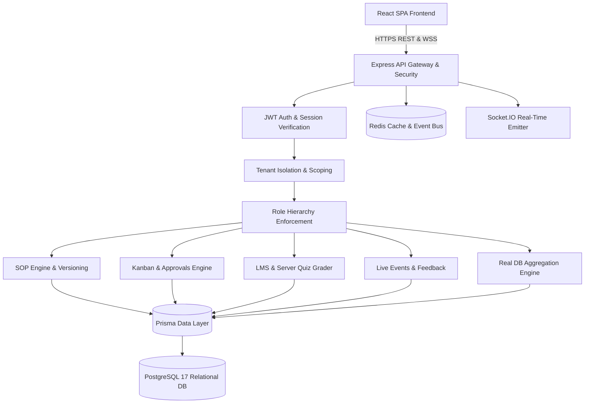

# AsyncFlow — System Architecture & Design Documentation

## 1. Architectural Philosophy

AsyncFlow is constructed as a **modular monolith** with clean separation of concerns. This architecture was chosen deliberately over premature microservices to maximize development velocity, maintain strict transactional consistency across related operational domains, and eliminate distributed networking latency.



---

## 2. Multi-Tenant Data Isolation Strategy

AsyncFlow implements strict logical multi-tenancy:

1. **Organization Scoping:** Every business entity (`SOP`, `Workflow`, `Department`, `Team`, `TrainingProgram`, `Workshop`, `ActivityLog`) contains a mandatory foreign key `organizationId`.
2. **Tenant Middleware Enforcement:** The `requireTenant` middleware enforces that `req.organizationId` matches an active membership belonging to the authenticated user. If a user tries to access a resource in an organization they do not belong to, a `403 Forbidden` is triggered immediately before any module handler executes.
3. **Database Query Isolation:** All repository and service queries explicitly include `where: { id, organizationId }` to prevent cross-tenant enumeration attacks.

---

## 3. Role-Based Access Control (RBAC) Matrix

| Capability / Resource | Super Admin | Org Admin | Team Manager | Employee |
| :--- | :---: | :---: | :---: | :---: |
| **Manage Organizations & Subscriptions** | ✅ | ❌ | ❌ | ❌ |
| **Manage Departments & Teams** | ✅ | ✅ | ❌ | ❌ |
| **Invite & Assign Member Roles** | ✅ | ✅ | ❌ | ❌ |
| **Author & Publish SOPs** | ✅ | ✅ | ✅ | ❌ |
| **Assign SOPs to Squads & Users** | ✅ | ✅ | ✅ | ❌ |
| **Read & Digitally Acknowledge SOPs** | ✅ | ✅ | ✅ | ✅ |
| **Create Workflows & Stages** | ✅ | ✅ | ✅ | ❌ |
| **Review & Sign Off Task Approvals** | ✅ | ✅ | ✅ | ❌ |
| **Author Training Programs & Quizzes** | ✅ | ✅ | ❌ | ❌ |
| **Take Lessons & Certification Exams** | ✅ | ✅ | ✅ | ✅ |
| **Schedule Interactive Workshops** | ✅ | ✅ | ✅ | ❌ |
| **Register & Attend Workshops** | ✅ | ✅ | ✅ | ✅ |
| **View Organization Analytics & Export CSV** | ✅ | ✅ | ✅ | ❌ |

---

## 4. Key Subsystem State Machines

### 4.1 SOP Document Lifecycle
```
[ DRAFT ] ---> [ IN_REVIEW ] ---> [ PUBLISHED ] ---> [ ARCHIVED ]
                     |                  |
                     v                  v
             (Feedback Comments)  (Version Bump v2)
                                        |
                                        v
                            (Re-acknowledgement Request)
```

### 4.2 Workflow Task Approval Gate
```
[ To Do ] ---> [ In Progress ] ---> [ In Review (Pending Signoff) ]
                                             |
                                  +----------+----------+
                                  |                     |
                                  v                     v
                            [ APPROVED ]          [ REJECTED ]
                                  |                     |
                                  v                     v
                            [ Completed ]         [ In Progress ]
```

### 4.3 Quiz & Anti-Cheat Grading Architecture
- **Question Retrieval:** The student endpoint `GET /training/quizzes/:id` strips all `isCorrect` fields before returning the payload, preventing browser inspection exploits.
- **Server-Side Grading:** The submission endpoint compares submitted option IDs directly against PostgreSQL records in an isolated transaction.
- **Certificate Verification:** Upon achieving a score $\ge$ passing score and completing 100% of module lessons, an irreversible digital certification code `ASYNC-CERT-[HEX]` is generated and recorded.

---

## 5. Real-Time WebSocket Architecture

Socket.IO rooms are scoped along two dimensions:
- `user:${userId}`: Directed notifications (e.g. task assignment, approval review status).
- `org:${organizationId}`: Broadcast notifications (e.g. newly published SOPs, upcoming company-wide workshops).
